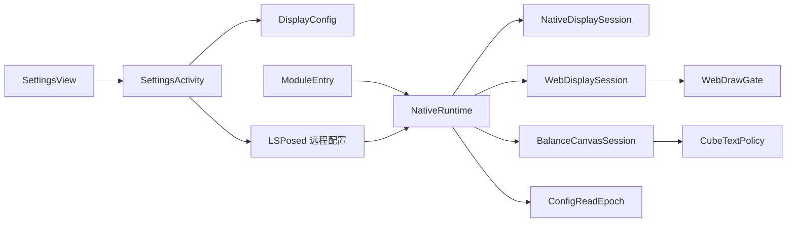

# 架构与代码边界

模块围绕设置配置和宿主显示两条链路组织。布局、纯策略和页面会话分别维护，具体页面的兼容规则保留在对应适配器中。



## 职责划分

| 组件                      | 职责                                         | 不承担的职责                 |
| ------------------------- | -------------------------------------------- | ---------------------------- |
| `SettingsView` / XML 资源 | 布局、控件绑定、系统栏与键盘边距、诊断区展开 | 远程配置、本机草稿、框架连接 |
| `SettingsActivity`        | 草稿、输入反馈、连接状态、异步保存及结果确认 | 宿主页面适配                 |
| `DisplayConfig`           | 不可变配置快照、十进制校验与金额格式         | UI、网络、账户数据           |
| `ModuleApp`               | 连接监听与设置页订阅                         | 宿主注入与金额匹配           |
| `ModuleEntry`             | API 102 入口、基础 Android 拦截注册与回滚    | 页面特例                     |
| `NativeRuntime`           | 后台读取、主线程快照发布、Activity 会话协调  | 具体金额的匹配与恢复         |
| `ConfigReadEpoch`         | 请求代次、过时读取拒绝与 pending 状态        | Android 对象和线程调度       |
| `NativeDisplaySession`    | 原生目标文本、朗读描述及绘制保护             | Web DOM / Cube 命令          |
| `WebDisplaySession`       | 文档握手、脚本调用、页面身份和 SDK 回调归属  | DOM 内部绑定策略             |
| `WebDrawGate`             | 显示回复与 visual 回调的有界门控状态机       | SDK 调用和页面身份识别       |
| `CubeTextPolicy`          | Cube 文本、金额、掩码与命令类型的纯分类      | Android 对象、采样与日志     |
| `BalanceCanvasSession`    | 精确主金额命令的私有绘制副本和归还           | 原业务命令、网络或支付模型   |
| `*Diagnostics` / `*Audit` | 白名单分类与验证计数                         | 扩大显示匹配范围             |

`*Policy`、独立状态类和 `*Profile` 用于隔离纯判断、状态转移及固定兼容条件。不要仅为缩短文件而引入通用反射工具或跨页面共享可变金额状态。

## 阅读顺序

大类先列生命周期与事件入口，内部按主要流程分组，纯辅助与嵌套类型置后。`NativeRuntime` 按配置/会话、拦截注册、Cube 观察和文档探针组织；`ModuleEntry` 将应用生命周期、原生文本、视图结构和 Web 绘制注册分开。具体成员与命名约定见 [贡献指南](../CONTRIBUTING.md#成员顺序与函数组织)。

`CubeTextPolicy` 由余额显示和结构诊断共同使用，生产显示不再依赖诊断类中的分类实现。两份 Web 脚本保持独立资源，在各自文档闭包内按命令、协调、归属、DOM 和纯工具函数组织。

## 配置与线程

四项金额使用十进制定点字符串保存，余额、余额宝、基金、总资产各自独立。输入接受非负普通十进制，最多两位小数、九位整数；不隐式舍入，也不接受逗号或科学计数法。配置一次读取完整快照，类型或协议不符时关闭显示。

远程读取与脚本资源读取在后台执行，Android 视图和会话变更在主线程执行。`ConfigReadEpoch` 的每次请求都推进代次，合并读取不能清除尚未发布的新请求。后台结果返回后必须再次确认代次、连接或页面身份。

设置页的保存成功表示框架确认写入；目标页面是否应用由页面会话单独判断。未保存草稿属于模块应用，不进入宿主业务数据。

## 页面与显示归属

- 原生会话延续至 `onStop`，避免退出动画提前恢复原数字。
- Web 文档会话保留至销毁；暂停只延后 Java 检查，同文档的显隐监听继续有效。原生导航、文档 nonce 或完整导航身份变化会使旧回调失效。
- 异步回调须绑定会话、代次、当前 View、页面身份及配置 revision。仅“回到前台”不构成新金额来源证明。
- 文本和朗读描述分别记录归属与新鲜度。隐藏后不使用旧数字恢复，模块自身输出也不能作为新宿主原文。
- 余额绘制使用私有 Canvas 和命令列表，仅替换主命令；`finally` 按引用归还，不能覆盖宿主重入期间换入的新对象。

这些约束是兼容规则。整理命名、格式、注释或抽取类时，应保留其状态转移与失败行为，并运行对应边界测试。

## 包名与资源布局

应用 ID 和 Java 命名空间统一为 `io.github.fengying.alipaydisplay`。`META-INF/xposed/java_init.list` 指向 `io.github.fengying.alipaydisplay.ModuleEntry`；支付宝作用域仍为 `com.eg.android.AlipayGphone`。

```text
app/src/main/java/io/github/fengying/alipaydisplay/          模块源码
app/src/test/java/io/github/fengying/alipaydisplay/          Java 测试
app/src/main/resources/io/github/fengying/alipaydisplay/     Web 脚本资源
app/src/visualStateBridge/java/io/github/fengying/alipaydisplay/bridge/
```

桥接类为 `io.github.fengying.alipaydisplay.bridge.VisualStateBridge`，生成资源为 `io/github/fengying/alipaydisplay/visual-state-bridge.dex`。源码目录、资源读取路径、桥接类名及生成任务须保持一致；宿主 SDK 的类名和包名不随模块包名迁移而改变。

包名变化会改变 Android 应用身份及 LSPosed 模块配置归属。安装和重新启用步骤见 [包名迁移说明](../README.md#从旧包名迁移)。

## 资源与构建

Web 脚本以表达式嵌入宿主调用，读取上限为 96,000 字节。脚本资源测试同时检查这个跨语言边界；DOM 测试使用合成节点验证显隐、身份变化、同值回声与清理。

SDK visual 回调为抽象类，因此以单类 DEX 桥适配。桥源码和编译桩分目录，Gradle 只将生成的桥 DEX 作为资源打包；编译桩和宿主 SDK 实现不进入 APK。不要手工编辑生成文件。

具体兼容版本、无闪现验证的覆盖范围和诊断流程见 [验证与诊断](verification.md)。
